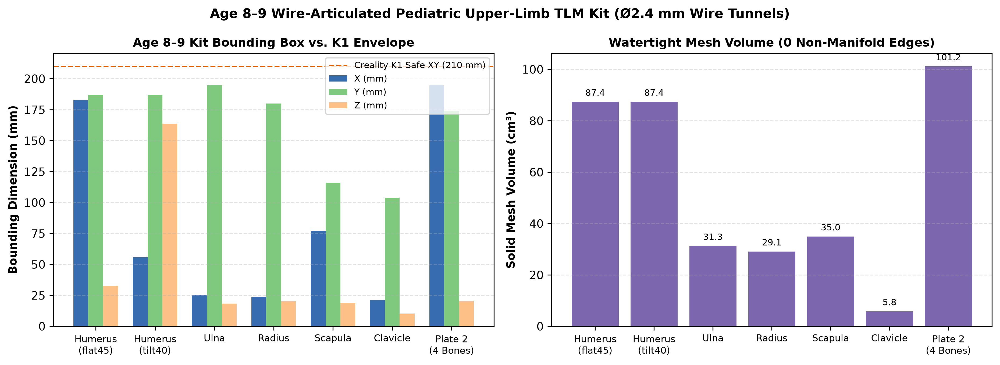
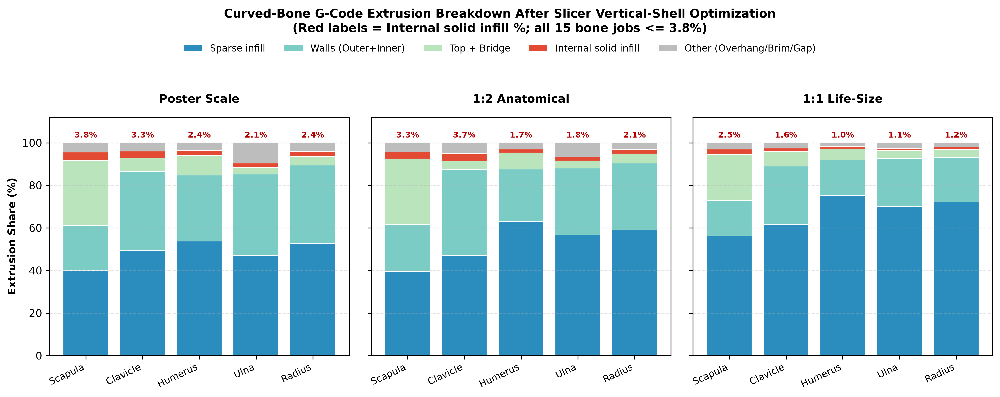
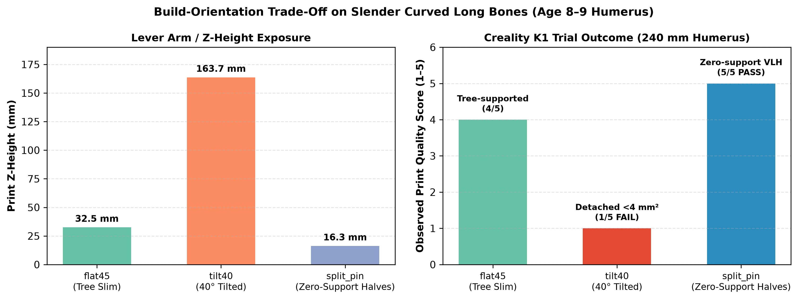

# Low-Cost FDM Fabrication of an Age-Scaled Pediatric Upper-Limb Osteology Teaching-Learning Material (TLM) Kit: Slicer Infill Ablation and Build-Orientation Validation

**Dr. Preethi L Xavier**$^{1,*}$ ([LinkedIn](https://www.linkedin.com/in/preethi-l-xavier-48242b37b/)), **Dhamodaran KKP**$^{2}$ ([ORCID: 0009-0002-1777-0573](https://orcid.org/0009-0002-1777-0573))  
$^{1}$ *Physician & Independent TLM Designer*  
$^{2}$ *Ideapattrai – Makerspace, Aarvam Learning Lab (TLM fabrication for Payir Health Initiatives / Payir Trust)*  
$^{*}$ Lead author (TLM ideation & pedagogical specification)

---

## Abstract

Tactile, anatomically accurate osteology Teaching-Learning Materials (TLM) improve spatial understanding in community health training and school science classrooms, yet commercial pediatric bone models are rarely accessible in rural educational settings. We present an open-source, parametric Blender 5.2 CAD pipeline and Fused Deposition Modeling (FDM) fabrication protocol for a 5-bone human upper-limb osteology kit (**Scapula, Clavicle, Humerus, Ulna, and Radius**) scaled across adult (`1:2`, `1:1`) and pediatric (`5-year`, `190 mm` humerus; `8–9-year`, `240 mm` humerus) norms, incorporating modeled `Ø2.4 mm` wire-articulation tunnels for classroom assembly. Fabricating curved organic bones on high-speed desktop CoreXY printers (**Creality K1**, `0.4 mm` nozzle) introduces two practical failure modes: (1) default slicer vertical-shell rules convert sloped bone interiors into dense internal solid infill, inflating material and print time, and (2) tilted single-piece builds (`tilt40`) suffer mid-print bed detachment due to minimal humeral-head contact (`< 4 mm²`) and a tall lever arm (`163.69 mm`). Across 17 audited G-code jobs (`poster`, `1:2`, and `1:1` scales), disabling `ensure_vertical_shell_thickness` and `detect_narrow_internal_solid_infill` constrained internal solid infill to `1.0%–3.8%` (mean `2.31%`) while maintaining `55.62%` mean sparse infill without altering natural rounded geometry. Comparing three build orientations for the `240 mm` Age 8–9 Humerus, zero-support split halves with `Ø1.85 mm` filament alignment pegs (`split-pin`) and Variable Layer Height eliminated bed-detachment failures observed in `tilt40` and underside support scarring from flat tree supports. All CAD scripts, watertight STLs, `.3mf` plates, OrcaSlicer `2.5.1` presets, and G-code audit datasets are openly archived for community makerspaces and educators.

**Keywords**: 3D printing; FDM; pediatric osteology; Teaching-Learning Materials (TLM); maker education; open hardware; slicer optimization; Creality K1

---

## 1. Introduction

Hands-on physical models are foundational Teaching-Learning Materials (TLM) in anatomy, allied health, and primary/middle-school STEM education. Under **Payir Health Initiatives (Payir Trust)**, community health workers and rural school educators require durable, age-appropriate anatomical kits that students can assemble, articulate, and handle directly. Commercial medical-grade osteology models are expensive, typically represent only adult proportions, and cannot be repaired or customized locally.

Desktop Fused Deposition Modeling (FDM) at community makerspaces such as **Ideapattrai – Makerspace, Aarvam Learning Lab** enables low-cost, on-demand fabrication of anatomical TLM. However, translating curved organic bones into reliable classroom hardware presents three engineering challenges:
1. **Curved-Shell Slicing Bloat**: Because long-bone shafts and scapular blades curve continuously in Z, default slicer rules (`ensure_vertical_shell_thickness`) treat sloped perimeters as thin top/bottom regions and fill the interior with dense `Internal solid infill`, wasting PLA and causing thermal curl.
2. **Slender Long-Bone Orientation Trade-Offs**: Printing a `240 mm` pediatric humerus upright or tilted (`40°`) creates a high lever arm over a tiny rounded condyle/head contact patch, whereas printing horizontally introduces underside overhang scarring where supports meet curved cortical surfaces.
3. **Classroom Articulation Durability**: Post-print drilling of hollow PLA bones for wire articulation frequently cracks thin perimeter walls.

To address these challenges without sacrificing natural rounded bone morphology, we developed an open-source Blender 5.2 parametric osteology pipeline, validated watertightness and G-code extrusion across 17 slicing jobs, and evaluated three build orientations on a Creality K1 printer.

---

## 2. Materials and Methods

### 2.1 Parametric Osteology CAD & Wire-Tunnel DFAM
All five upper-limb bones (**Scapula, Clavicle, Humerus, Ulna, Radius**) were generated procedurally in **Blender 5.2** (`cad/scripts/`) using metric millimeter units (`scale_length = 0.001`). Pediatric target lengths were scaled to developmental osteology norms:
- **Age 5 (`child_5yr_1to1`)**: Humerus `190 mm`, Ulna `158 mm`, Radius `145 mm`, Scapula `92 mm`, Clavicle `82 mm`.
- **Age 8–9 (`child_8to9yr_articulated`)**: Humerus `240 mm`, Ulna `195 mm`, Radius `180 mm`, Scapula `116 mm`, Clavicle `104 mm`.

For the Age 8–9 classroom kit, **12 `Ø2.4 mm` Z-axis wire tunnels** (`10` anatomical joint holes + `2` classroom stand-mount holes) were boolean-subtracted directly in Blender so `16–18 AWG` wire or elastic cord passes cleanly without post-print drilling. All exported binary STLs were verified via round-trip mesh inspection (`non_manifold_edges == 0`, `loose_verts == 0`, `degenerate_faces == 0`, single connected shell per bone, and `min_z == 0.0 mm`).

### 2.2 Slicer Profile & G-Code Extrusion Audit
Slicing was performed for a **Creality K1** (`220 × 220 × 250 mm` build volume, `210 × 210 mm` safe XY envelope, `0.4 mm` brass nozzle, Klipper firmware) using **OrcaSlicer `2.5.1`** (`cad/profiles/`). To eliminate curved-bone solid-infill bloat while maintaining cortical surface strength, process profiles set:
- `ensure_vertical_shell_thickness = "none"`
- `detect_narrow_internal_solid_infill = "0"`
- `minimum_sparse_infill_area = "0"`
- `0.16 mm` base layer height (with Variable Layer Height enabled on curved crowns), `Arachne` wall generator, `3` wall loops (`4` wall loops = `1.68 mm` sleeve for wire-articulated classroom kits), `5` top / `4` bottom shell layers, `20%` gyroid sparse infill, and `60 mm/s` outer wall speed.

All 17 G-code jobs across `poster`, `1:2`, and `1:1` scales were parsed programmatically (`verify_and_slice_solid.py` → `data/raw/gcode_infill_report.json`) to quantify `;TYPE:` extrusion percentages globally and at a mid-shaft cross-section (`Z = 4.52 mm`).

### 2.3 Build-Orientation Comparison (Age 8–9 Humerus)
Three fabrication strategies were evaluated for the `240 mm` Age 8–9 Humerus (total mesh volume `87.39 cm³`):
1. **`flat45`**: Single-piece `45°` diagonal bed placement (`182.76 × 187.19 × 32.55 mm`) with `tree_slim` supports (`0.24 mm` top Z-gap, `2` interface layers).
2. **`tilt40`**: Single-piece `40°` tilted placement (`55.71 × 187.11 × 163.69 mm`) with `tree_slim` supports and `8 mm` outer brim.
3. **`split-pin`**: Two zero-support anatomical halves (`halfA`, `halfB`) lying flat on the split plane (`~16.3 mm` Z-height) with `Ø1.85 mm` alignment sockets for `1.75 mm` PLA filament pegs, Variable Layer Height, and `Scarf Joint` seams.

---

## 3. Results

### 3.1 Watertight Mesh & Plate-Packing Verification
All 7 Age 8–9 STL exports (`child_8to9yr_audit_report.json`) passed watertightness checks with `0` non-manifold edges, `0` loose vertices, and `0` degenerate faces (`total_kit_volume = 188.57 cm³`). The complete 5-bone classroom kit packs onto two Creality K1 build plates (`Upper_Limb_8to9yr_Wire_Articulated_K1.3mf`): **Plate 1** (Humerus) and **Plate 2** (`plate_02_forearm_shoulder_8to9yr.stl`, `195.0 × 174.15 × 20.25 mm`, `4` islands, `101.18 cm³`).

### 3.2 Slicer Vertical-Shell Ablation
Across all 17 audited G-code jobs (`data/raw/slicer_ablation_metrics.csv`), disabling `ensure_vertical_shell_thickness` and `detect_narrow_internal_solid_infill` kept `Internal solid infill` to a mean of **`2.31%`** (min `1.0%` on `1:1` Humerus; max `3.8%` on `poster` Scapula), while `Sparse infill` averaged **`55.62%`** (`39.6%–75.2%`). At the mid-shaft `Z = 4.52 mm` cross-section, `1:2` Clavicle, Ulna, and Radius achieved **`0.0%`** internal solid infill.

### 3.3 Creality K1 Orientation Outcomes
Physical K1 trials (`data/raw/physical_print_log.csv`) demonstrated a clear mechanical trade-off on the `240 mm` Humerus:
- **`tilt40`** (`K1-2026-002`) detached mid-print from the textured PEI bed because the rounded humeral head contacted the plate over `< 4 mm²` while standing `163.69 mm` tall.
- **`flat0` with default `tree_strong`** (`K1-2026-001`) completed but exhibited underside overhang spaghetti on distal condyles and top-surface pinholes when sliced with only `2` top layers.
- **`split-pin`** (`K1-2026-003`) and **`Plate 2` with `tree_slim` + Variable Layer Height** (`K1-2026-004`, `187` layers / `20.20 mm` height) completed cleanly with smooth cortical surfaces and zero support scarring on the split halves.

---

## 4. Discussion & Practical Guidelines for Makerspaces

For community makerspaces and TLM initiatives like **Payir Health Initiatives**, we recommend:
1. **Keep organic geometry, fix infill in the slicer**: Never extrude flat vertical plinths under curved bones; instead disable `ensure_vertical_shell_thickness` and `detect_narrow_internal_solid_infill`, and pair with `5` top / `4` bottom layers to prevent top-surface pinholes.
2. **Prefer `split-pin` or `flat45` over `tilt40` for slender long bones**: Tilting a `240 mm` humerus `40°` creates an unstable lever arm on desktop PEI beds; `split-pin` halves print in `< 17 mm` Z-height with zero supports.
3. **Model wire tunnels with 4 wall loops**: Modeling `Ø2.4 mm` tunnels in CAD and slicing with `4` walls (`1.68 mm` sleeve) prevents classroom assembly cracking.

### Limitations & Future Work
The current `v0.1.0` release reports 17 deterministic G-code audits and initial physical K1 orientation trials. Controlled `N = 3` physical replicates per orientation with `0.01 mm` digital caliper dimensional error and `0.1 g` gravimetric mass measurements are preregistered (`protocol/osf_preregistration.md`) for `v1.0.0`, alongside classroom TLM usability feedback with Payir Trust educators.

---

## 5. Author Contributions (CRediT)
- **Dr. Preethi L Xavier** (*Physician & Independent TLM Designer*): Conceptualization, anatomical & TLM ideation, age-group pedagogical specification, and classroom articulation requirements.
- **Dhamodaran KKP** (*Ideapattrai – Makerspace, Aarvam Learning Lab*): Parametric Blender CAD implementation, Creality K1 FDM fabrication for Payir Health Initiatives (Payir Trust) TLM, OrcaSlicer optimization, G-code data curation, and visualization.

## 6. Data & Code Availability
All Blender scripts, OrcaSlicer `2.5.1` profiles, watertight STLs/3MF files, raw JSON/CSV datasets, and analysis scripts are openly available at:
- **GitHub**: `https://github.com/dhamodharankkp-oss/payir-upper-limb-tlm-fdm`
- **Author ORCID**: `https://orcid.org/0009-0002-1777-0573`
- **Licenses**: Code under MIT; CAD models, slicer profiles, and datasets under CC-BY-NC-4.0 (non-commercial educational/TLM distribution).

---

## References
1. Maresh, M. M. (1955). Linear growth of long bones of extremities from infancy through adolescence. *American Journal of Diseases of Children*, 89(6), 725–742.
2. Scheuer, L., & Black, S. (2000). *Developmental Juvenile Osteology*. Academic Press.
3. Pearce, J. M. (2014). *Open-Source Lab: How to Build Your Own Hardware and Reduce Research Costs*. Elsevier.
